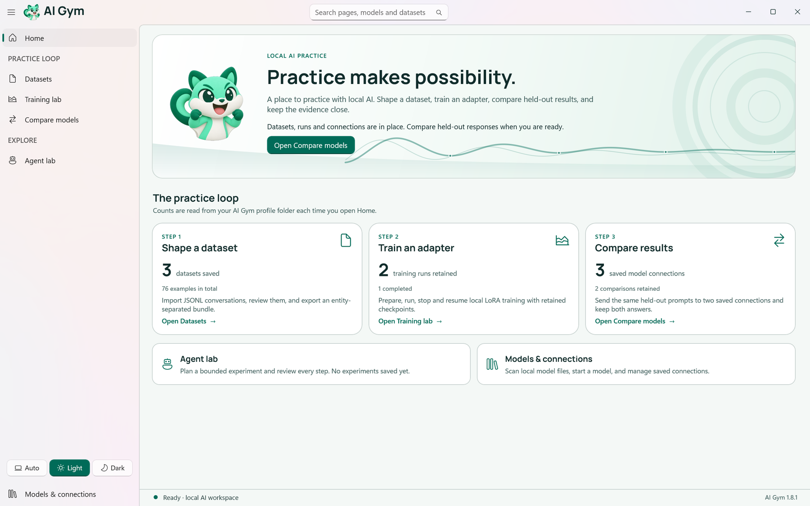
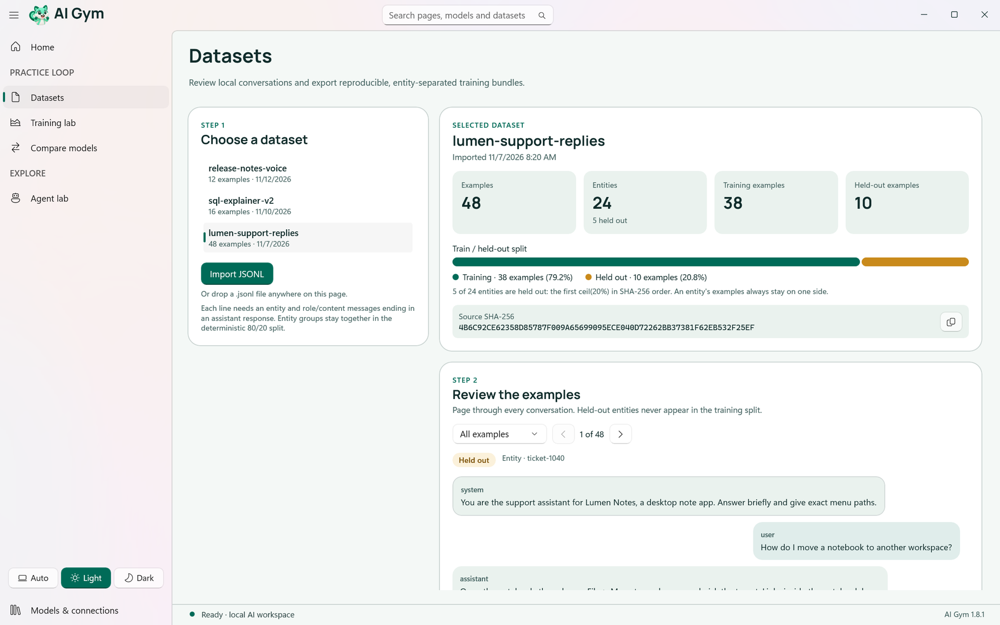
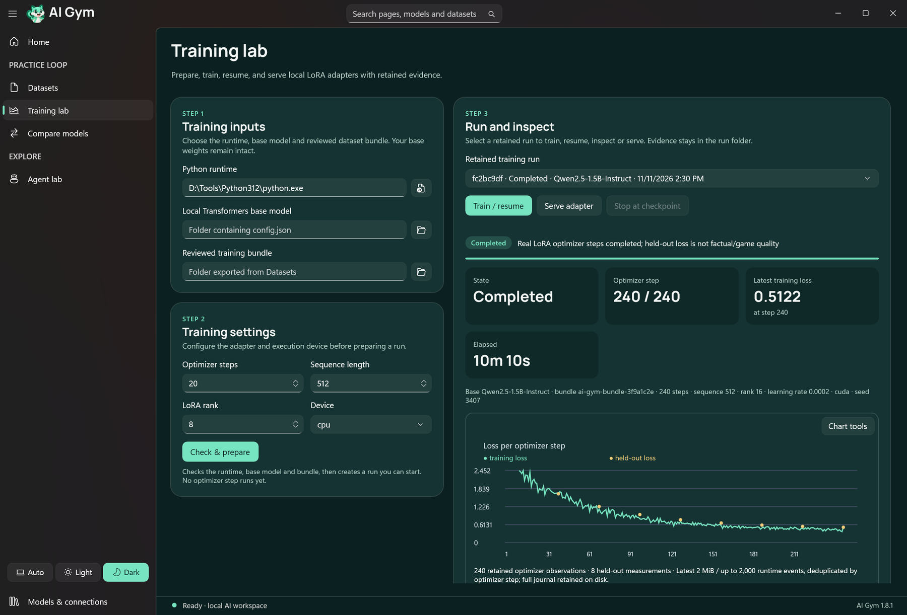
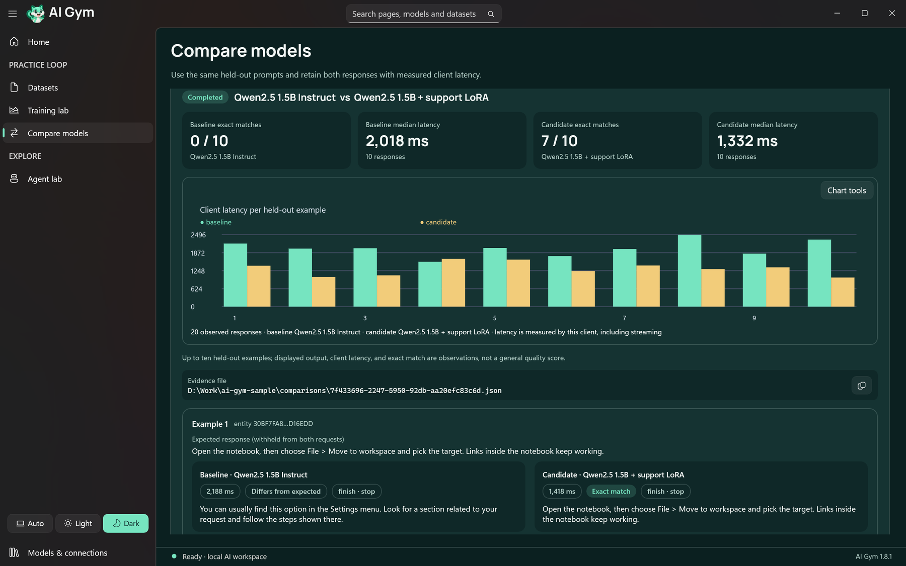

<div align="center">


# AI Gym

**Practice makes possibility.** A native Windows workspace for practising with local AI:
shape a dataset, train a LoRA adapter, compare held-out answers, and keep the evidence.

[Website](https://ai-gym.site) ·
[Download](https://github.com/afj176/ai-gym/releases/latest) ·
[Installer (x64)](https://github.com/afj176/ai-gym/releases/latest/download/AiGym-Setup-x64.exe) ·
[Portable ZIP](https://github.com/afj176/ai-gym/releases/latest/download/AiGym-win-x64.zip)

</div>

<picture>
  <source media="(prefers-color-scheme: dark)" srcset="docs/images/home-dark.png">
  
</picture>

## What it does

- **Datasets** – import JSONL conversations, page through every example, and see a deterministic
  80/20 train / held-out split that keeps each entity's examples on one side. After you approve the
  review, export a training bundle (`train.jsonl`, `evaluation.jsonl` and a SHA-256 manifest).
- **Training lab** – train a LoRA adapter on a local Transformers base model with your own Python
  runtime. Stop at a checkpoint, resume later, follow training and
  held-out loss on a chart, then serve the finished adapter.
- **Compare models** – send the same held-out prompts to two saved model connections and keep both
  answers, exact matches and measured client latency in an evidence file.
- **Models & connections** – scan folders for GGUF and Transformers models, start them with llama.cpp's
  `llama-server` or Python, download from Hugging Face, and save loopback
  connections to OpenAI-compatible servers you already run.
- **Agent lab** – let a local chat model plan a small experiment from a fixed set of tools; every
  step waits for your approval before it runs.

## Screenshots

| Datasets | Training lab |
| --- | --- |
|  |  |



## Install

Download from the [latest release](https://github.com/afj176/ai-gym/releases/latest):

| | File | Notes |
| --- | --- | --- |
| Installer | `AiGym-Setup-x64.exe` (~91 MB) | Per-user install under `%LOCALAPPDATA%\Programs\AiGym`, no admin rights. Windows 11. |
| Portable | `AiGym-win-x64.zip` (~105 MB) | Extract anywhere and run `AiGym.exe`; keep the folder together. Windows 10 2004 (build 19041) or later. |

Builds are not code-signed yet, so Windows SmartScreen may warn on first run: choose
**More info → Run anyway**. SHA-256 files are attached to each release.

**Requirements:** Windows x64. .NET and the Windows App SDK are bundled. Model weights and runtimes
are not: point AI Gym at your own models under **Models & connections**, plus a Python environment
with PyTorch, Transformers and PEFT for training and Transformers serving, and/or llama.cpp's
`llama-server.exe` for GGUF models.

**Where data lives:** `%LOCALAPPDATA%\AiGym` (datasets, training runs, comparisons, connections
and settings). Set `AIGYM_DATA_HOME` to use another folder. If a file named `portable.flag` sits
next to `AiGym.exe`, the app uses the `data` folder beside it instead. Endpoint keys you choose to remember are
encrypted with Windows DPAPI for your account.

## Build from source

Prerequisites: Windows 10/11 x64, the [.NET 10 SDK](https://dotnet.microsoft.com/download), and
[Inno Setup 6](https://jrsoftware.org/isinfo.php) only if you want the installer. The Windows App
SDK comes from NuGet.

```powershell
# Run a Debug build
dotnet build src\AiGym\AiGym.csproj -c Debug -p:Platform=x64
.\src\AiGym\bin\x64\Debug\net10.0-windows10.0.19041.0\win-x64\AiGym.exe

# Self-contained release folder + ZIP in artifacts\ (add the installer with -Installer)
.\scripts\Publish.ps1 -Version 1.8.1
.\scripts\Publish.ps1 -Version 1.8.1 -Installer -InnoCompiler "C:\Program Files (x86)\Inno Setup 6\ISCC.exe"
```

`Publish.ps1` refuses to overwrite an existing version and writes a SHA-256 inventory of the payload.

### Checks

The three suites under `tests/` are console programs that need no model, GPU or network; each
takes a scratch folder and prints `PASS` lines:

```powershell
dotnet run --project tests\AiGym.DatasetChecks -- $env:TEMP   # import, split and export bundles
dotnet run --project tests\AiGym.LabChecks     -- $env:TEMP   # Agent lab review gate and checkpoints
dotnet run --project tests\AiGym.ModelChecks   -- $env:TEMP   # launch arguments, loopback-only endpoints
```

`scripts\Verify-LocalTraining.py <folder>` runs real CPU LoRA training on a tiny synthetic model
and needs a Python environment with PyTorch, Transformers and PEFT. More notes are in
[docs/DEVELOPMENT.md](docs/DEVELOPMENT.md).

## Privacy

Everything stays on your PC: datasets, runs and evidence are plain files in your profile folder, and
model connections must be loopback addresses (`localhost` / `127.0.0.1`). AI Gym goes online only
when you ask it to: searching and downloading models from Hugging Face, or setting up the optional
quantized-model runtime (packages from PyPI). No telemetry.

## License

[MIT](LICENSE). Manrope is used under the SIL Open Font License 1.1; see
[THIRD-PARTY-NOTICES.md](THIRD-PARTY-NOTICES.md).
