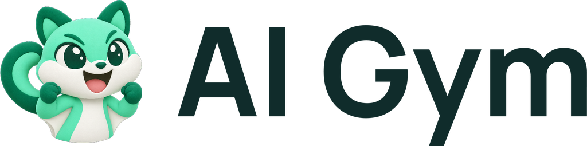
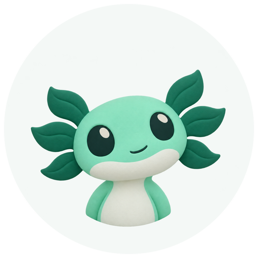
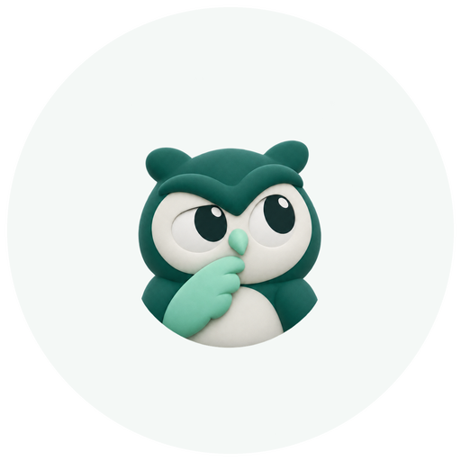

# AI Gym brand guide

AI Gym is a Windows app for practising with local AI: shape a dataset, train an adapter, compare held-out answers from two models and keep the evidence on your own PC. The identity is about repetition that leads somewhere. The logo is Spring, the mascot, beside the AI Gym wordmark, and the tagline finishes the thought: **Practice makes possibility.**

<picture>
  <source media="(prefers-color-scheme: dark)" srcset="logo-kit/png/logo-dark-1024w.png">
  
</picture>

## The mascot

**Spring** is a flying squirrel modelled in soft, matte clay: mint fur, evergreen ears and tail, a cream face and large dark eyes. Spring is alert, encouraging and slightly cheeky, the training partner who thinks you have one more attempt in you.

Four companions share the same clay and colours. **Ripple** the axolotl is quietly observant, **Tempo** the owl is patient and methodical, **Pivot** the turtle is thoughtful and resourceful, and **Zip** the rabbit is playful and hard to discourage.

    

Where Spring appears in the app:

- **Title bar and app icon.** A 32 px Spring sits next to the wordmark in the title bar, and the taskbar icon is Spring too.
- **Home.** Spring cheers beside the tagline ("You got this") and shrinks when the window is narrow.
- **Empty states.** Spring sits above a short title and one next step. "You got this" invites a start, "I'm listening" waits for a file or a search, and "Let me think" marks a comparison or an experiment that has not been opened.
- **Results.** "That worked" plays once as a short animation when an export or a training run finishes, then settles to a still. "Try again" replaces the artwork when something fails. If animations are turned off in Windows, only the stills are shown.

Eight pieces of mascot art ship with the app, one for each of Spring's moods; the pages use five of them today. The companions are for profiles, documentation and community spaces, and do not appear in the app.

Please don't:

- Put Spring on the working surfaces, such as charts, tables and training logs.
- Let Spring claim a result. A celebration appears only after something has actually finished.
- Recolour Spring, crop the ears or tail, or place the round portraits on a busy background.
- Loop the animations. Each one plays once.

## Logo

The logo is Spring and the wordmark side by side. There is no separate symbol: where a square mark is needed, Spring stands alone.

| File (in `logo-kit/png`) | Use it for |
| --- | --- |
| `logo-light` | The default: Spring and the wordmark in ink, on light backgrounds. 512, 1024 and 2048 px wide, transparent. |
| `logo-dark` | The same lockup with the wordmark in paper white, for dark backgrounds. |
| `mascot` | Spring alone: favicons, profile pictures, app icons and other square spaces. 64 to 1024 px, transparent. |
| `brand-wordmark-outlined` | The lettering alone, also as SVG in `logo-kit/svg`. The app and the website place it next to Spring. |

- **Minimum size.** In marketing and print, keep Spring at least 32 px tall in the lockup, which makes the whole logo about 130 px wide. Alone, Spring can go down to 16 px for a favicon. The app's 48 px title bar uses a compact lockup instead: a 32 px Spring and a 78 px wide wordmark, which works there because the window frames it.
- **Clear space.** Leave a margin of a quarter of Spring's height on every side, the same as the gap between Spring and the wordmark.
- **Do** use `logo-light` on light backgrounds and `logo-dark` on dark ones, and keep Spring to the left of the wordmark.
- **Don't** stretch, rotate or recolour the logo, add shadows or outlines, swap Spring for another character, or set the name in a font yourself. The wordmark is drawn artwork (Manrope at weight 750, converted to outlines).

`logo-kit/preview/logo-usage.png` shows both lockups and Spring alone on one sheet.

## Colour

Greens throughout: a pale, cool paper, deep evergreen ink and one strong green for action. The dark theme is a separate set of colours, not the light one inverted. `tokens.json` and `tokens.css` hold the same values for code.

**Light theme**

| Swatch | Hex | Used for |
| --- | --- | --- |
| Paper | `#F4F8F6` | Page background |
| White | `#FFFFFF` | Cards and panels; text on green buttons |
| Mist | `#EAF2EE` | Quiet inset areas, such as loading placeholders |
| Ink | `#102C2B` | Text and the wordmark |
| Muted | `#405F5D` | Secondary text and captions |
| Accent | `#006B58` | Buttons, links, selected items and progress |
| Line | `#667F79` | Strong borders; ordinary borders use it at 30% opacity |
| Ochre | `#7A4E00` | Warning text |
| Brick | `#A3302B` | Error text |
| Gold | `#C98A1B` | The held-out share in dataset split charts |

**Dark theme**

| Swatch | Hex | Used for |
| --- | --- | --- |
| Night | `#0B2020` | Page background; text on mint buttons |
| Raised | `#153332` | Cards and panels |
| Deep | `#0F2828` | Quiet inset areas |
| Paper | `#F4F8F6` | Text |
| Silver | `#B7D2CB` | Secondary text and strong borders; ordinary borders use it at 20% opacity |
| Bright | `#76E4C0` | Buttons, links, selected items and progress, with Night text |
| Sand | `#F2CC7A` | Warning text and the held-out share in charts |
| Blush | `#FFA59E` | Error text |

Contrast, measured with the WCAG formula: Ink on Paper is 13.8:1, Muted on Paper 6.5:1, Accent on Paper 6.0:1 and white on Accent 6.5:1. In dark, Paper on Night is 15.8:1, Silver on Night 10.6:1 and Night on Bright 11.0:1. Line on Paper is 4.0:1, enough for borders and not for text. When Windows high contrast is on, the app drops the brand colours and uses the system ones.

## Typography

- **Manrope** (SIL Open Font License 1.1) for the wordmark and for headings, which are set bold. The font file and its licence are in `logo-kit/fonts`.
- **Segoe UI Variable**, the Windows system font, for controls and body text. It is part of Windows and is not shipped with the app.

## Voice

Encouraging and exact. AI Gym tells you what to do next and what has really happened, and never dresses up a result.

| Write | Rather than |
| --- | --- |
| "Bring some conversations" | "No dataset loaded." |
| "No training runs yet. Fill in the inputs, then choose Check & prepare." | "Start crushing it with your first run!" |
| "Nothing is downloaded until you review and confirm a download." | "Downloads are safe and secure." |
| "Nothing is shown until responses are actually observed." | "Results will appear here shortly." |
| "Existing bundles are never overwritten." | "Don't worry, your data is fine." |
| "Both answers, exact matches and measured latency go into an evidence file you can reopen any time." | "See which model is smarter." |

Say what is saved, where it goes and what still needs your approval. A saved connection is not a running model, and a finished run is not proof that the model got better.

## Files in this folder

| Path | What it holds |
| --- | --- |
| `tokens.json`, `tokens.css` | The palette, light and dark theme colours and fonts, for code |
| `logo-kit/png`, `logo-kit/svg` | The logo files listed above: the lockups at 512 to 2048 px wide, Spring alone from 64 to 1024 px, and the wordmark as PNG (512 to 4096 px wide) and SVG |
| `logo-kit/favicon` | Spring as favicons, touch icons and a web manifest |
| `logo-kit/preview` | The logo usage sheet |
| `logo-kit/fonts` | Manrope and its licence |
| `characters` | Spring and the four companions on round backdrops, 512 px |
| `graphics` | Share images as PNG: 1200 × 630 Open Graph, 1080 × 1080 square, 1500 × 500 header, a 1024 px profile picture and a 512 px maskable icon |

The app keeps its own copies of the art it shows, including the mascot art, in [`src/AiGym/Assets`](../src/AiGym/Assets). The website is in [`site`](../site).

## Licence

Everything in this repository, code and artwork alike, is under the [MIT licence](../LICENSE). Manrope is under the [SIL Open Font License 1.1](logo-kit/fonts/LICENSE-Manrope.txt).
